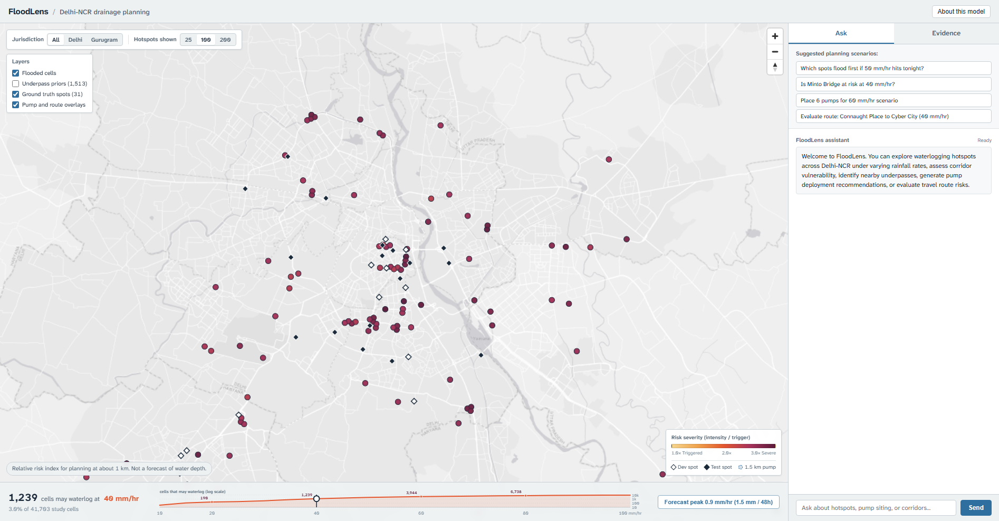
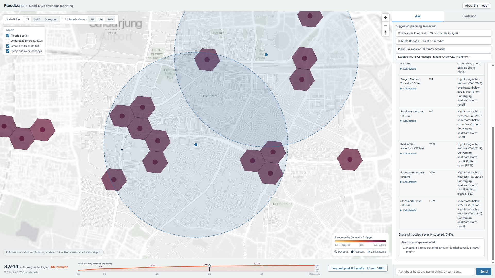
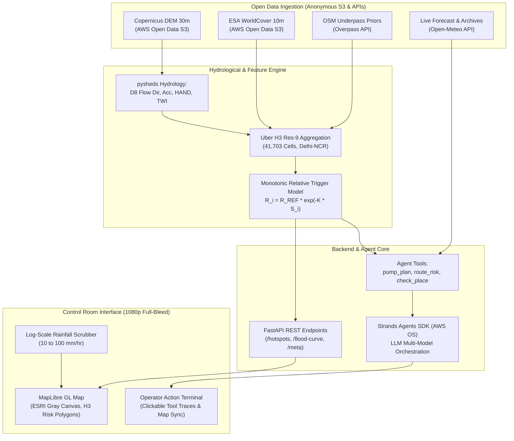

# FloodLens: Municipal Urban Waterlogging Early Warning for Delhi-NCR

> **An urban waterlogging early-warning decision tool for municipal drainage control rooms in Delhi-NCR, ranking 41,703 hexagonal corridors by passive hydrological susceptibility and deploying emergency pumps via an AWS open-source AI agent.**



---

## 1. Problem & Target Users

Every monsoon season, sudden cloudbursts and high-intensity rainfall paralyze the National Capital Region (Delhi-Gurgaon). Municipal drainage and traffic control rooms face severe operational bottlenecks:
- **No Early Warning**: Control rooms rely on reactive emergency dispatch after water has already accumulated and citizens report stranded vehicles.
- **Blind Asset Deployment**: Emergency dewatering pumps are pre-positioned based on static intuition or memory rather than quantitative catchment hydrology.
- **Subterranean Sinks**: Standard 30 m digital elevation models (DEMs) capture elevated flyovers and building rooftops, failing to detect subterranean underpasses and railway culverts that turn into immediate drownings sinks (e.g., Minto Bridge, Hero Honda Chowk).

**Target User**: Municipal drainage and traffic police control room operators evaluating impending storm scenarios (e.g., *"With 50 mm/hr approaching, which 25 spots will waterlog first, and where should our 6 emergency pumps be pre-positioned?"*).

---

## 2. What FloodLens Does

1. **Dynamic Rainfall Scenario Scrubber (10–100 mm/hr)**: An interactive logarithmic rainfall slider models passive waterlogging progression across 41,703 Uber H3 res-9 hexagonal cells (~174 m edge length).
2. **Prioritized Hotspot Ranking**: Ranks urban transit corridors by modelled susceptibility score ($S \in [0, 1]$), showing immediate trigger thresholds ($R_i \text{ mm/hr}$) and plain-language physical rationales.
3. **Conversational Control Room Agent**: Powered by the **Strands Agents SDK** (AWS open-source), the assistant answers operational questions with structured tool-calling traces and live map overlays:
   - `get_hotspots(mm_per_hr, top_n, city)`: Ranked flood-exposed cells.
   - `check_place(place, mm_per_hr)`: Instant risk diagnosis for critical intersections and underpasses.
   - `pump_plan(n_pumps, mm_per_hr, radius_m)`: Greedy coverage optimization pre-positioning mobile pumps to maximize covered flood severity.
   - `route_risk(origin, destination, mm_per_hr)`: Evaluates waterlogging risk along evacuation and transit corridors.
   - `get_forecast(location)`: Fetches live 48-hour precipitation forecast from Open-Meteo.
4. **Empirical Evidence & Benchmark Dashboard**: Built-in evaluation tab presenting held-out validation recall against news-reported flood events with 95% bootstrap confidence intervals.



---

## 3. How It Works: System Architecture



### 6-Line Pipeline Summary
1. **Ingest**: Copernicus DEM 30 m tiles and ESA WorldCover are streamed anonymously from AWS Open Data public S3 buckets.
2. **Hydrology**: `pysheds` extracts D8 flow accumulation, slope, Topographic Wetness Index (TWI), and Height Above Nearest Drainage (HAND).
3. **Priors**: OpenStreetMap Overpass queries extract subterranean highway tunnels, culverts, and underpasses as sink priors.
4. **Aggregate**: Surface rasters are rasterized and aggregated into 41,703 H3 resolution-9 hexagonal cells across Delhi-NCR.
5. **Score**: A composite susceptibility index ($S$) and exponential trigger threshold ($R_i$) determine flood sequence order.
6. **Serve**: FastAPI serves sub-second spatial GeoJSON tiles to a MapLibre GL frontend, orchestrated by an AWS Strands AI agent.

---

## 4. Built on AWS: Hackathon Route

FloodLens follows the **"Build It"** route for the Environmental Hacks hackathon:
- **Zero AWS Account Required**: Runs entirely locally on a developer laptop without recurring cloud infrastructure bills.
- **AWS Open-Source Core**: The entire conversational assistant is built on the **Strands Agents SDK** (`strands-agents`), an official open-source AWS agent library:
  ```python
  # Evidence from agent/agent.py & agent/tools.py:
  from strands import Agent, tool
  from strands.models.gemini import GeminiModel
  from strands.models.anthropic import AnthropicModel
  from strands.models.ollama import OllamaModel
  ```
- **AWS Open Data Registry**: The data ingestion pipeline anonymously accesses public AWS Open Data S3 buckets (`copernicus-dem-30m` and `esa-worldcover`) without requiring AWS credentials (`AWS_NO_SIGN_REQUEST=YES`).

---

## 5. Benchmark Results & Honest Assessment

FloodLens was evaluated against an immutable ground-truth dataset extracted from verified journalistic reports across two independent splits. All metrics are computed strictly once with frozen model weights:

### Held-Out Test Split (Delhi Red-Alert Extreme Rain, 2026-07-28; $n=17$)

| Model / Baseline | Recall@25 [95% CI] | Recall@50 [95% CI] | Recall@100 [95% CI] | Recall@200 [95% CI] | Cutoff Ties (K=200) |
|---|---|---|---|---|---|
| **FloodLens (Composite)** | **5.9%** [0.0–17.6%] | **11.8%** [0.0–29.4%] | **35.3%** [11.8–58.8%] | **58.8%** [35.3–82.4%] | **1** |
| **Underpass Prior Only** | 11.3% [0.0–29.4%] | 21.4% [5.9–47.1%] | 35.3% [17.6–64.7%] | 51.1% [23.5–70.6%] | 618 |
| **Random Uniform Baseline** | 1.5% [0.0–17.6%] | 2.8% [0.0–29.4%] | 6.0% [0.0–29.4%] | 10.8% [0.0–35.3%] | 0 |
| **TWI Only** | 0.0% [0.0–0.0%] | 0.0% [0.0–0.0%] | 0.0% [0.0–0.0%] | 5.9% [0.0–17.6%] | 2 |
| **Built-up Only** | 1.0% [0.0–0.0%] | 2.1% [0.0–0.0%] | 4.2% [0.0–0.0%] | 5.7% [0.0–17.6%] | 233 |
| **HAND Only** | 0.0% [0.0–0.0%] | 0.0% [0.0–0.0%] | 0.0% [0.0–0.0%] | 0.0% [0.0–0.0%] | 9 |
| **Flow Acc Only** | 0.0% [0.0–0.0%] | 0.0% [0.0–0.0%] | 0.0% [0.0–0.0%] | 0.0% [0.0–0.0%] | 1 |
| **Elevation Only** | 0.0% [0.0–0.0%] | 0.0% [0.0–0.0%] | 0.0% [0.0–0.0%] | 0.0% [0.0–0.0%] | 2 |

*Note on Baseline Definitions*: The **Random Uniform** baseline is drawn uniformly at random from the **full 41,703 H3 res-9 study area hex pool**. For discrete baselines with tied values, ties are broken uniformly at random and averaged over 200 draws (`seed=42`).

### Key Findings & Honest Disclosures
1. **Significant Lift Over Random Baseline**: FloodLens achieves **58.8% Recall@200** on held-out test data compared to **10.8%** for uniform random selection.
2. **Comparison with Underpass Heuristic**: The standalone Underpass Prior achieves **51.1% Recall@200**. A paired bootstrap analysis reveals a difference of **+7.8% (95% CI [-23.5%, +35.3%])**. Because this confidence interval crosses zero, **the performance difference is not statistically distinguishable from zero at sample size $n=17$**.
3. **Operational Value of Composite Scoring**: While the underpass prior provides strong top-of-list signal, it suffers from severe tie degeneracy (618 tied hexes). FloodLens breaks these ties, adds corridor-level catchment coverage, and provides dynamic rainfall scenario scaling.
4. **Gurugram Spots in DEV Split Only**: All Gurugram ground-truth locations exist exclusively in the DEV split. **No Gurugram generalization is claimed on the test split.**

### Reproducing Benchmark Numbers
```bash
# Verify ranking invariance and exact recall match against committed baseline:
python eval/verify_invariance.py

# Verify text consistency across documentation and results.json:
python eval/check_text_consistency.py
```

---

## 6. Honest Limitations & Failure Modes

- **Corridor Resolution (~1 km)**: While individual H3 res-9 cells are ~174 m, urban flood propagation occurs across interconnected road corridors. The tool provides corridor-level prioritization, not sub-meter puddle mapping.
- **Relative Index, Not Water Depth**: Scores represent relative topographical susceptibility and display thresholds, not calibrated hydrodynamic water depths or physical flood volume.
- **30 m Surface Model Occlusion**: Copernicus DEM is a digital surface model (DSM) capturing tree canopies and building rooftops. Elevated structures mask depressions beneath them. *Known edge case*: At Minto Bridge, the geocoded underpass node is 244 m from the host hex center, causing the 174 m underpass buffer to miss it in its primary cell.
- **News-Reported Ground Truth ($n=17$)**: Locations represent landmark centroids and intersection midpoints rather than surveyed sensor telemetry. 
- **ERA5 Precipitation Smoothing**: Global reanalysis models smooth intense localized cloudbursts over ~25–30 km grid boxes. No real-time dynamic storm replay is claimed.
- **Passive Hydrology Only**: Does not ingest real-time drain siltation, pump electrical failure telemetry, or active construction diversions.
- **LLM Boundary**: The Strands agent reasons strictly over deterministic tool outputs; it does not hallucinate meteorological forecasts.

---

## 7. Data Sources & Licenses

| Dataset / Tool | Provider | License / Terms of Use | Verification Status |
|---|---|---|---|
| **Copernicus DEM GLO-30** | European Space Agency / Airbus | [Copernicus Sentinel Data Policy](https://spacedata.copernicus.eu/terms-and-conditions) (Open & Free access) | Verified |
| **ESA WorldCover 2021** | European Space Agency | [Creative Commons Attribution 4.0 International (CC BY 4.0)](https://esa-worldcover.org/en/data-access) | Verified |
| **OpenStreetMap & Overpass** | OpenStreetMap Foundation | [Open Database License (ODbL) 1.0](https://www.openstreetmap.org/copyright) | Verified |
| **Open-Meteo Weather API** | Open-Meteo GmbH | [CC BY-NC 4.0 International](https://open-meteo.com/en/terms) (Non-commercial open weather models) | Verified |
| **Nominatim Geocoding** | OpenStreetMap Foundation | [Nominatim Fair Use Policy](https://operations.osmfoundation.org/policies/nominatim/) | Verified |
| **World Light Gray Canvas** | Esri, HERE, Garmin, INCREMENT P | [Esri Master License Agreement](https://www.esri.com/en-us/legal/terms/full-master-agreements) | Verified |
| **Uber H3 Spatial Index** | Uber Technologies | [Apache License 2.0](https://github.com/uber/h3/blob/master/LICENSE) | Verified |
| **Strands Agents SDK** | Amazon Web Services (AWS) | [Apache License 2.0](https://github.com/strands-agents/sdk-python/blob/main/LICENSE) | Verified |

---

## 8. Run Instructions & Setup

### Prerequisites
- Python 3.11 (via `uv` recommended)
- Node.js 20+
- Git
- Chromium browser (Edge or Chrome)

### Windows PowerShell

```powershell
# 1. Clone repository
git clone https://github.com/TANMaYtO/AMHS.git
cd AMHS

# 2. Set up virtual environment and install dependencies
uv venv --python 3.11 .venv
.\.venv\Scripts\Activate.ps1
uv pip install -r requirements.txt

# 3. Configure API key
Copy-Item .env.example .env
# Edit .env and add your GEMINI_API_KEY (never commit this key!)

# 4. Install frontend dependencies
cd web
npm install
cd ..

# 5. Start FastAPI Backend (Terminal 1)
.\.venv\Scripts\python.exe -m uvicorn api.main:app --host 127.0.0.1 --port 8000

# 6. Start Vite Frontend (Terminal 2)
cd web
npm run dev
# Open http://localhost:5173 in browser
```

### macOS / Linux / Bash

```bash
# 1. Setup environment via Makefile
make setup

# 2. Configure .env
cp .env.example .env
# Add GEMINI_API_KEY into .env

# 3. Start Backend & Frontend
make api   # Starts FastAPI on port 8000
make web   # Starts Vite on port 5173
```

---

## 9. Troubleshooting Guide (Fresh Machine Setup)

- **Port 8000 Already in Use (`[Errno 10048]`)**: A background uvicorn process may hold the socket. In PowerShell, identify and terminate the process:
  ```powershell
  Get-Process python* | Stop-Process -Force
  ```
- **NumPy 2.x Compatibility with pysheds**: Pysheds 0.5 invokes deprecated `np.in1d`. FloodLens includes a pre-installed compatibility bridge in `engine/terrain.py`:
  ```python
  if not hasattr(np, "in1d"):
      np.in1d = np.isin
  ```
- **Overpass Rate Limiting (`HTTP 429 / 504`)**: When regenerating sink priors across the large bounding box, Overpass may rate-limit. FloodLens automatically tiles queries into 0.25° sub-boxes with exponential backoff.
- **Missing Baseline Hardcoded Paths**: Ensure you run eval scripts from the project root using relative imports.

---

## 10. Next Steps

1. **Municipal Sensor Telemetry**: Calibrate rainfall trigger thresholds with real-time SCADA drain sensors and municipal stormwater pump telemetry.
2. **IMD Doppler Radar Integration**: Ingest real-time radar nowcasts to replace global ERA5 smoothing with localized 15-minute convective storm tracking.
3. **Multi-City Expansion**: Deploy the open pipeline across additional vulnerable urban basins (Mumbai, Bengaluru, Chennai) using local ground-truth calibration.

---

## 11. License

This project is licensed under the MIT License — see the [LICENSE](LICENSE) file for details.
